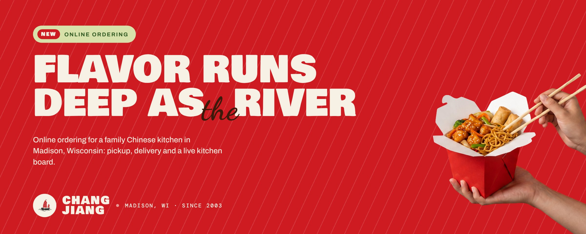
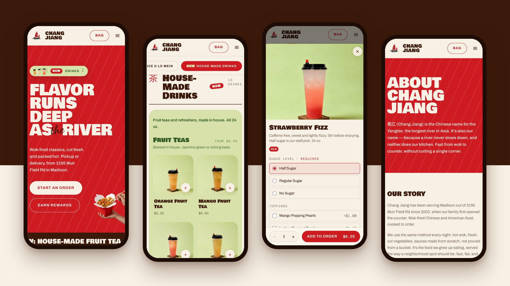
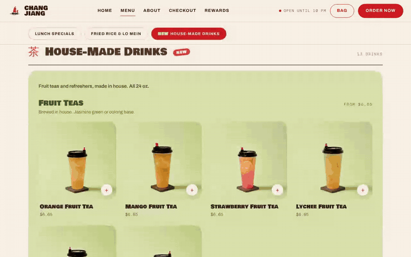
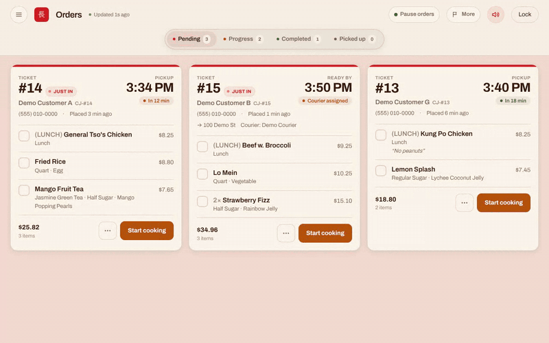
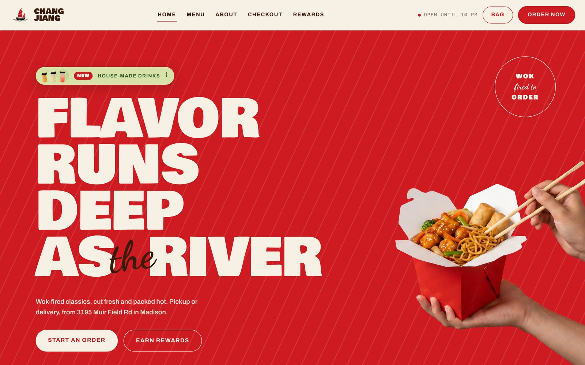
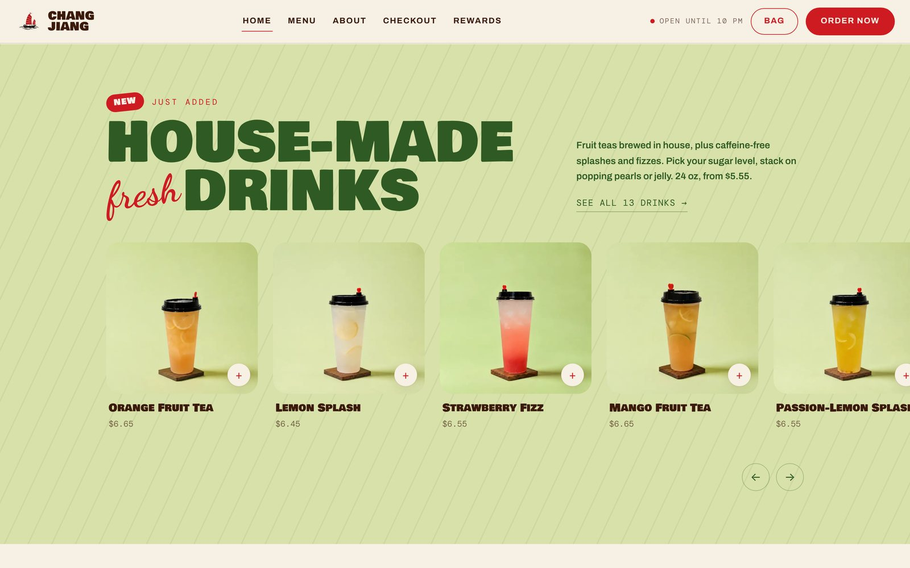
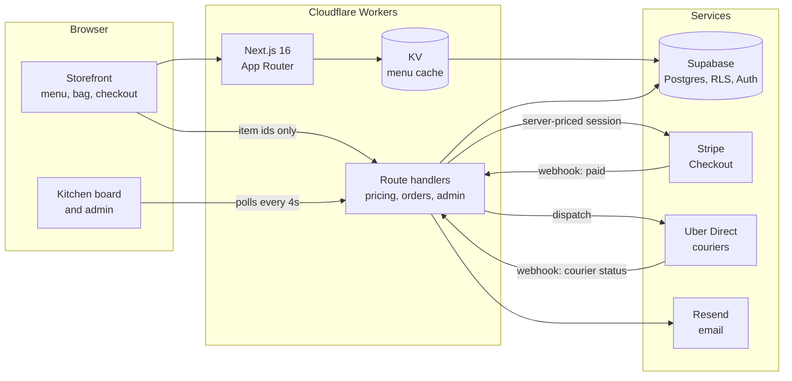

  

<h1 align="center">Chang Jiang</h1>

  <strong>Online ordering for a family Chinese kitchen in Madison, Wisconsin.</strong> 
  A storefront customers order from, and the kitchen board the staff cook from.

  
  
  
  
  
  
  

---

Chang Jiang has been cooking out of 3195 Muir Field Rd since 2003. I built the restaurant its own online ordering site, from the menu customers see to the board the kitchen works from. Customers order pickup or delivery from the menu, pay by card, and earn points. The kitchen works from a live board that rings when an order lands, and staff run the menu, stock, coupons and refunds themselves.

This repo is a showcase: the source code is private.

  

## See it work

These were recorded from a local build using the restaurant's real drinks and lunch menus. The orders on the kitchen board are invented demo data, not real customers.

<table>
  <tr>
    <td width="50%" valign="top">
       
      <strong>Ordering.</strong> Every dish opens a sheet of its options. Required choices are preselected, add-ons can repeat, and the price updates as you go.
    </td>
    <td width="50%" valign="top">
       
      <strong>The kitchen board.</strong> A new order takes over the screen and keeps ringing until someone taps it. Then the ticket moves through Pending, Progress, Completed and Picked up.
    </td>
  </tr>
  <tr>
    <td width="50%" valign="top">
       
      <strong>The storefront.</strong> A live open/closed indicator, run on Chicago time no matter where the visitor is.
    </td>
    <td width="50%" valign="top">
       
      <strong>House-made drinks.</strong> A photo-led layout of its own for the fruit teas and refreshers, set on a panel matched to the drink photography.
    </td>
  </tr>
</table>

## What's in it

| | |
|---|---|
| **Menu and ordering** | Search, a sticky category rail, and an options sheet for every dish. Lunch specials can only be ordered until 3 PM, and items marked sold out stay on the menu greyed out. |
| **Checkout** | Pickup in 15-minute slots, or ASAP delivery with a "ready in ~N min" estimate from the order's size and the kitchen queue. Coupons, points and tip, then payment on Stripe Checkout. |
| **Delivery** | Couriers are dispatched through Uber Direct once an order is paid, with live status on the confirmation page. Delivery is limited to a 6-mile radius and a $15 minimum. |
| **Kitchen board** | A wall screen for the line. It rings on new orders, can push a delivery back +5 or +10 minutes, pauses online orders until morning (turning the whole board red), and flags courier problems. |
| **Menu editor** | Staff edit dishes, prices and photos, rearrange categories, attach shared add-on groups, and mark stock out for today. Every change saves a backup of the whole menu first, with one-step restore. |
| **Money after checkout** | Staff can add a charge or a refund to an order after it's been paid. |
| **Loyalty and coupons** | 10 points per dollar, redeemable at 200 points per dollar off, with a 24-hour pending window. Coupons can target specific dishes and options. Customers who leave a Google review get free crab rangoon. |
| **Accounts** | Magic-link sign-in, order history with one-tap reorder, and branded confirmation emails. |
| **Analytics** | Revenue by day, orders by hour, and top dishes for any date range. |

## How it's built

A Next.js app running on Cloudflare Workers, in front of Supabase. Stripe and Uber Direct report back by webhook, and their webhooks decide an order's state, not the browser.

| | |
|---|---|
| **Frontend** | Next.js 16 (App Router), React 19 and TypeScript, styled with Tailwind CSS 4 on a small set of design tokens shared by the storefront and the admin. |
| **Backend** | Route handlers on Cloudflare Workers via OpenNext. Supabase Postgres with row-level security for the menu, orders, coupons and the loyalty ledger, plus Supabase Auth for customers. |
| **Integrations** | Stripe Checkout and webhooks, Uber Direct for dispatch and courier status, Resend for email, and the US Census geocoder for the delivery radius. |
| **Shipping** | Deployed to Cloudflare Workers on the restaurant's own domain, with the menu cached in Workers KV. |

### A few things I'm proud of

- **The browser never sets a price.** The bag sends item ids, choices and quantities. The server reprices every line from the database, applies coupons and points, and opens Stripe Checkout with its own total. Only the payment webhook marks an order paid, and unpaid orders never reach the kitchen.
- **A menu model that survives the printed menu.** The paper menu says things like "+$0.40 for vegetable", but that upcharge is different by the pint than by the quart. So nothing is stored as an upcharge. Every combination of size and protein carries its own absolute price.

  | | base | variant | pint upcharge | quart upcharge |
  | --- | --- | --- | --- | --- |
  | Fried Rice | Egg 5.80 / 8.80 | Vegetable 6.20 / 8.90 | +0.40 | **+0.10** |
  | Lo Mein | Plain 4.50 / 8.50 | Vegetable 7.20 / 10.25 | +2.70 | **+1.75** |

- **Sold out expires on the clock, not the cache.** The menu is cached for a day, so "out for today" is stored as a time and checked against the clock on every render. It clears at 4 AM on its own.
- **Deploys never strand an open tab.** Each deploy carries the previous builds' hashed CSS and JS forward for two weeks, so a phone that reopens an old tab mid-dinner still gets a styled page.
- **A kitchen board you can't miss.** New orders fill the screen and ring through Web Audio until someone taps. If a courier is late or cancels, the board says so and shows the support number.
- **Staff access without passwords to manage.** One shared PIN, stored only as a scrypt hash and rate-limited per IP. Each device also has to be confirmed from an emailed link, and that trust expires at local midnight.

## Access

The storefront is at [changjiangmadison.online](https://changjiangmadison.online). The kitchen board and admin are staff-only.

---

© 2026 William Li. All rights reserved. The images and recordings in this repository may not be reused without permission. Chang Jiang's name, logo and photography belong to the restaurant.

